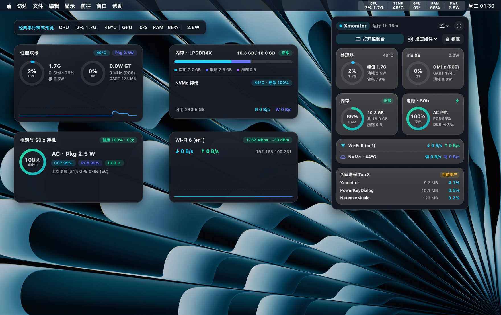
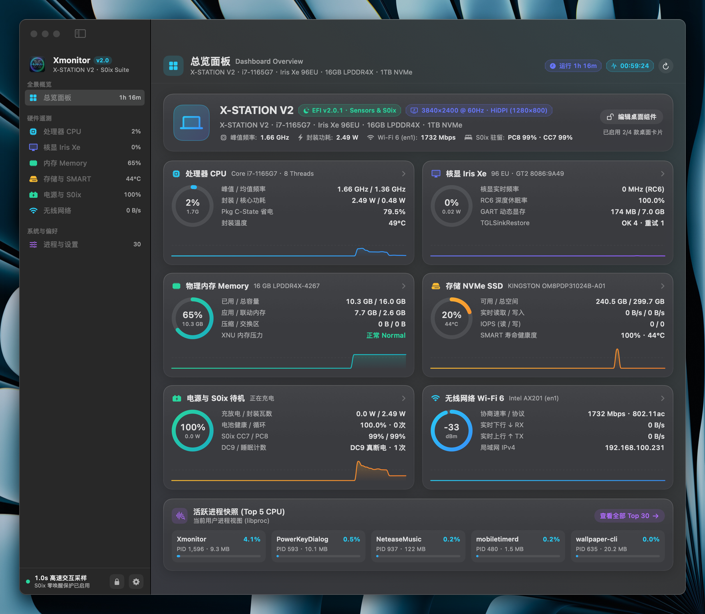
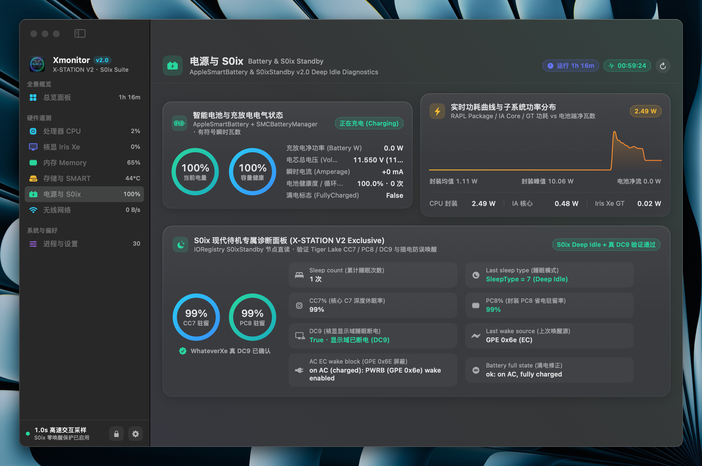
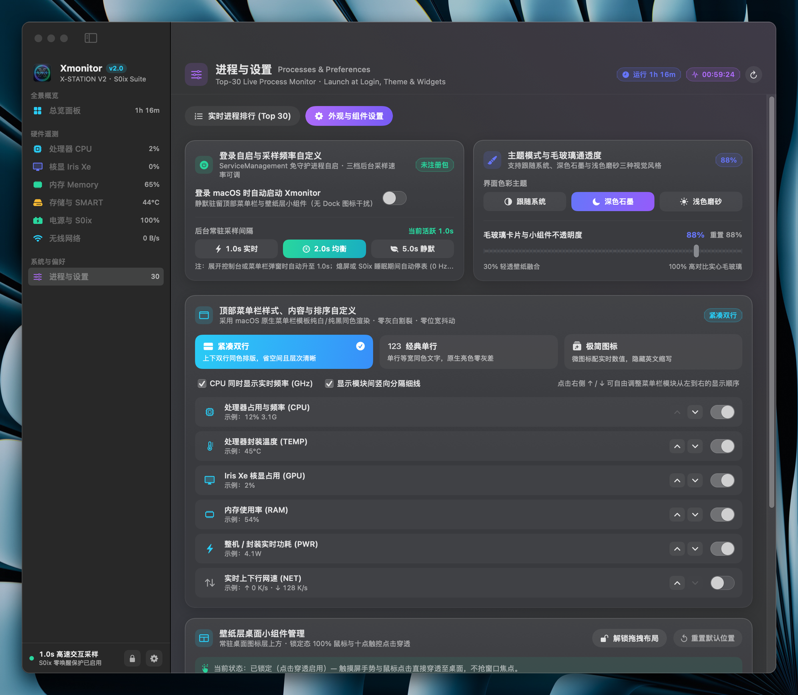

# Xmonitor — Native Hardware Telemetry Suite for X-STATION V2

**Xmonitor** (`com.xstation.xmonitor`) 是一款专为 **X-STATION V2**（Intel Core `i7-1165G7` · `Iris Xe 96EU` · `16GB LPDDR4X-4267` · `Kingston 1TB NVMe` · `Intel AX201 Wi-Fi 6` · `13.4" 3840×2400 @ 60Hz` · `EFI v2.0.1 S0ix`）量身打造的原生 macOS 硬件监控套件。

它兼具 **现代毛玻璃卡片美学** 与 **Tiger Lake 黑苹果硬件级读数精度**，在单一普通用户态进程内同时驱动 **顶部菜单栏 + 速览面板**、**壁纸层常驻桌面小组件** 与 **8 页签深度主控制台**，常驻 CPU 占用低于 `0.3%`，内存 `RSS < 45 MB`，且 **100% 不破坏核显 `RC6` 与整机 `S0ix` 现代待机**。

---

## 实机界面预览（X-STATION V2 · macOS Sequoia 15.8.1）

### 顶部同色菜单栏 · 速览弹窗 · 壁纸层常驻小组件


### 主控制台 · 全景概览与 S0ix 现代待机专属诊断
| 全景概览 (`Overview`) | 电源与 S0ix 深度待机诊断 (`CC7/PC8 99% · 真 DC9`) |
| :---: | :---: |
|  |  |

### 外观主题 · 采样频率 · 菜单栏样式与模块顺序自定义


---

## 核心特性

### 1. 三端一体 · 单源驱动 (`TelemetryEngine`)
- **顶部菜单栏 + 速览面板 (`NSStatusItem` + `NSPopover`)**
  - 原生菜单栏模板图像（`isTemplate = true`）纯白/纯黑同色渲染，**零暗灰反差割裂**、**零左右抖动**。
  - 支持 **三种菜单栏样式一键切换**（`紧凑双行` / `经典单行` / `极简图标`）、**模块前后顺序自由调整**、CPU 频率子开关与模块竖向分隔线开关。
  - 点击展开 `340pt` 速览卡：2×2 核心圆环仪表、实时网速/磁盘条、Top-3 活跃进程与快捷样式切换菜单。
- **壁纸层桌面小组件 (`DesktopWidgetPanel`)**
  - 驻留于 `kCGDesktopIconWindowLevel + 1`（壁纸与桌面图标上方、所有普通应用窗口下方，`F11 / 显示桌面` 保持可见），突破 `WidgetKit` 15 分钟刷新限制，支持秒级曲线跳动。
  - **四款独立卡片**：`性能双核 (CPU + Iris Xe)`、`内存与存储 (RAM + NVMe)`、`电源与 S0ix 待机`、`无线网络 (Wi-Fi 6)`，支持 `S / M / L` 三档尺寸与 `30%–100%` 毛玻璃不透明度调节。
  - **锁定穿透 vs 解锁吸附**：日常默认 `ignoresMouseEvents = true`，鼠标点击与 VoodooI2C 十点触控手势 **100% 穿透至桌面**；一键解锁后显现青色虚线编辑框，支持 `8pt` 网格吸附拖拽与归一化坐标自适应持久化。
- **8 页签 Sensei 主控制台 (`ConsoleWindowController`)**
  - **动态 Dock 策略**：日常以 `LSUIElement`（`.accessory`）无 Dock 图标静默运行；打开控制台时自动切换 `.regular` 显示窗口与 Dock 图标，关闭窗口后自动切回 `.accessory` 隐藏 Dock 图标。
  - **8 大导航视图**：
    1. **总览面板 (`Overview`)**：`X-STATION V2` 硬件头图 + 6 张可点击跳转的实时圆环曲线摘要卡 + Top-5 活跃进程快照。
    2. **处理器 (`CPU`)**：8 线程独立利用率与 `APERF/MPERF` 实时 MHz 柱状矩阵、60 点负载与 RAPL 封装功耗面积图、Package `C2–C10` 省电驻留分布、可选核心温度。
    3. **核显与显示 (`Iris Xe`)**：真实 `RC0` 忙碌率 60 点曲线、`RC6` 休眠率、GT `PP1` 独立功耗、零 Forcewake 实时频率、防下溢 `GART` 显存池、`3840×2400 @ 60Hz` 内屏与 `TGLSinkRestoreRate` 唤醒链路健康度。
    4. **内存 (`Memory`)**：`App / Wired / Compressed / Cached` 四色圆环拆解、XNU 内存压力状态灯、60 点占用曲线与 `VM Swap` 交换区详情。
    5. **存储与 SMART (`Storage`)**：APFS 根卷容量、实时读写 `MB/s` 与 `IOPS` 双曲线、Kingston NVMe 完整 `Log Page 0x02` SMART 体检表（剩余寿命 `%`、温度 `°C`、备用块 `%`、累计读写 `TB`、通电小时数、通电次数、不安全关机计数）。
    6. **电源与 S0ix (`Power & S0ix`)**：有符号充放电瓦数、电压/电流/循环健康度，以及本机独家 **S0ix 现代待机诊断面板**（`Sleep count`、`SleepType=7`、`CC7%`、`PC8%`、`DC9` 真断电确认、`Last wake source`、`AC EC wake block`、`Battery full state`）。
    7. **无线网络 (`Network`)**：`en1` Intel AX201 Wi-Fi 6 四联圆环仪表（`RSSI`、`Noise`、`SNR`、`TxRate Mbps`）、上下行实时带宽波形、免定位授权隐私友好展示及 `IPv4 / IPv6` 一键复制。
    8. **进程与设置 (`Processes & Settings`)**：可搜索/按 CPU% 或物理内存排序的 **Top-30 实时进程表** + 完整设置面板（`SMAppService.mainApp` 登录自启、主题与透明度、菜单栏模块勾选、桌面小组件管理与位置重置）。

---

## 原生零子进程硬件数据源 (`HardwareBridge.c`)

Xmonitor **严禁后台 `fork/exec` 外部命令行工具**（零 `top`/`ps`/`ioreg`/`vm_stat` 调用），所有数据均由进程内 C11 / Swift 原生系统 API 直读并复用长连接句柄：

| 子系统 | 原生接口与硬件寄存器数据源 | 关键修正与安全保证 |
|---|---|---|
| **CPU 频率 / 功耗 / C-State** | `libIOReport` (`pmtelemetry_cpu`: `ACNT/MCNT`、`PKG/PP0_ENERGY_STATUS`、`PKG_C2..C10`) + Mach `host_processor_info` | 免 `sudo` 精度 `±1 MHz`，`uint32` RAPL 能量回绕安全 |
| **CPU 温度（可选）** | `AppleSMC` UserClient (`TC0P`/`TC0D`, `TC0C..TC3C`) | 未装 `SMCProcessor.kext` 时自动优雅降级显示 `—` |
| **Iris Xe 核显** | `libIOReport` (`GPU C-States`: `RC0/RC1/RC6`) + `PP1_ENERGY` + `IntelAccelerator` (`gartUsedBytes`, `TGLSinkRestoreRate`) | 绕过恒为 `0` 的 `Device Utilization %` 与下溢的 `inUseSysMemoryBytes`；严格**零 `FORCEWAKE`** |
| **物理内存与 Swap** | Mach `HOST_VM_INFO64` + `sysctl` (`hw.memsize`, `vm.swapusage`, `vm.compressor_mode`, `kern.hv_support`) | 对齐 macOS 活动监视器口径，展示按需 Swap 与 VT-x 状态 |
| **NVMe 存储与 SMART** | `IOBlockStorageDriver` 差分吞吐/IOPS + `NVMeSMARTLib.plugin` (`SMARTReadData` Log Page `0x02`) | SMART 慢速层每 `30s` 轮询一次，零磁盘额外唤醒 |
| **电池与 S0ix 待机** | `AppleSMC` (`ACIN`/`B0AC`/`B0AV`) + `AppleSmartBattery` + `S0ixStandby` | 绕过 IOReg 30–60s 刷新滞后，自动识别 ACPI `mWh/mW` 原始功率并融合 RAPL 连续跟踪放电净流 |
| **Wi-Fi 6 与网络** | BSD `getifaddrs` (`AF_LINK` / `AF_INET` / `AF_INET6`) + `CoreWLAN` | Sequoia 无定位权限下自动回退接口链路展示，不弹窗 |
| **Top-30 进程排行** | `libsysmon.dylib`（配合 `AMFIPass` 免 `root` 全系统进程）+ `<libproc.h>` 自动回退 | 仅在控制台或下拉面板可见的交互态按需采样 |

---

## 自适应采样与 S0ix 零功耗保护

- **高速交互档 (`1.0s`)**：主控制台窗口打开（且未最小化）或菜单栏 Popover 展开时启用，同时开启 Top-30 进程采样。
- **常驻节能档 (`2.0s`)**：控制台与 Popover 关闭，仅保留顶部菜单栏与桌面小组件时自动降档，停止全进程扫描，常驻平均 CPU `< 0.3%`。
- **慢速健康档 (`30.0s`)**：NVMe SMART 与磁盘容量每 `30s` 顺带刷新。
- **睡眠/关屏零唤醒 (`0 Hz`)**：监听 `NSWorkspace` `willSleepNotification` 与 `screensDidSleepNotification` 立即销毁定时器；唤醒后自动重置差分基线，杜绝跨睡眠尖峰。

---

## 零 Xcode 构建、测试与部署

本项目仅依赖 macOS **Command Line Tools**（`clang` + `swiftc`，最低部署目标 `-target x86_64-apple-macos14.0`），无需安装 `Xcode.app` 或任何第三方包。

### 1. 在 X-STATION V2 (macOS) 本机编译与安装

```bash
# （可选，首次执行一次）创建本地自签名证书 "XSensei Dev"
./scripts/create-dev-cert.sh

# 编译打包 build/Xmonitor.app（自动打包 Retina AppIcon.icns）
./scripts/build-app.sh

# 编译并安装启动 /Applications/Xmonitor.app
./scripts/build-app.sh --install

# 若本机已启用 AMFIPass.kext，可开启 sysmond 全系统进程权限签名编译
ENABLE_SYSMOND_ENTITLEMENT=1 ./scripts/build-app.sh --install

# 编译并运行原生单元与硬件桥接测试套件
./scripts/run-tests.sh
```

### 2. 从 Linux 开发机远程同步至 X-STATION V2 编译测试

在项目根目录配置 `.testmac.env`（包含 `MAC_HOST=user@ip` 与 `MAC_PASSWORD=...`，已在 `.gitignore` 中忽略）：

```bash
# 同步源码并远程编译 build/Xmonitor.app
./scripts/remote-build.sh

# 远程编译并在真机执行全部测试
./scripts/remote-build.sh --test

# 远程编译、安装并启动 /Applications/Xmonitor.app
./scripts/remote-build.sh --install
```

### 3. CLI 单次 JSON 快照自检

```bash
/Applications/Xmonitor.app/Contents/MacOS/Xmonitor --dump-json
```

---

## 可选内核只读传感器扩展 (`EFI v2.0.1`)

XSensei 在当前生产环境 `EFI v2.0` 上**免重启即可完整运行**。如需进一步点亮 Tiger Lake 平台的 **CPU 核心温度 (`°C`)** 与 **Iris Xe 实时频率 (`MHz`)**，可升级至配套 `xstation-v2-hackintosh` 仓库 `feat/sensors-v2.0.1` 分支提供的只读传感器包：
1. `SMCProcessor.kext`（`VirtualSMC 1.3.8` 官方组件，导出 `TC0P` / `TC0C..TC3C`）。
2. `S0ixStandby` 只读影子寄存器扩展（仅在 `D0` 活跃态按需读取 `GEN12_RPSTAT1 0x1381B4`，零 Forcewake 导出 `"GPU Current Freq MHz"`）。

---

## 目录结构

```text
xsensei/
├── README.md
├── Resources/
│   └── XSensei.entitlements          # 默认签名权限配置
├── scripts/
│   ├── create-dev-cert.sh            # 创建本地 "XSensei Dev" 代码签名证书
│   ├── build-app.sh                  # clang + swiftc 编译打包与安装脚本
│   ├── run-tests.sh                  # 免 XCTest 原生测试编译与执行脚本
│   └── remote-build.sh               # Linux -> X-STATION V2 增量同步编译脚本
├── Sources/
│   ├── Bridge/
│   │   ├── HardwareBridge.h          # C11 硬件采样接口与结构体定义
│   │   └── HardwareBridge.c          # IOReport / Mach / SMC / SMART / Core / libsysmon 实现
│   ├── Core/
│   │   ├── Models.swift              # SystemSnapshot 强类型不可变/值语义数据模型
│   │   ├── RingBuffer.swift          # 60 点零重分配定长环形缓冲
│   │   ├── SettingsStore.swift       # UserDefaults 响应式持久化存储
│   │   └── TelemetryEngine.swift     # 自适应采样调度器与睡眠挂起控制
│   ├── UI/
│   │   ├── Theme/                    # Sensei 毛玻璃主题、RingGauge、AreaSparkline、格式化器
│   │   ├── MenuBar/                  # 顶部等宽状态栏与 340pt 速览 Popover
│   │   ├── Widgets/                  # 壁纸层穿透/拖拽吸附桌面小组件
│   │   └── Console/                  # 8 页签 Sensei 主控制台与动态 Dock 窗口控制器
│   └── App.swift                     # @main 应用入口与 CLI --dump-json 模式
└── Tests/                            # 环形缓冲、格式化、布局与硬件桥接测试
```
